# FlyUp — meses de fôlego

Calculadora que mostra, em segundos e sem cadastro, quantos meses você aguenta se der o salto de carreira — sem salvar nenhum valor financeiro.


[](https://flyup-folego.lovable.app)


**Demo (sem login):** https://flyup-folego.lovable.app
**Capítulo 1, o conceito:** [dio-lab-vibe-coding-app-financas](https://github.com/Pablit0rg/dio-lab-vibe-coding-app-financas)

> **Seus números ficam com você.** O cálculo roda no navegador e nenhum valor financeiro é enviado ou salvo. O FlyUp guarda só nome, WhatsApp, carreira-alvo (opcional), data e consentimento, e apenas de quem pede contato.

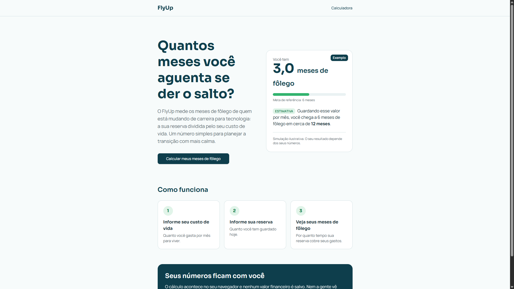

Entrega do desafio **MeuNegócio.AI** do bootcamp *Construa seu primeiro App com IA* (DIO e Santander): um MVP feito para provar, ou derrubar, a tese de um negócio.

## Como avaliar

- Abra a [demo](https://flyup-folego.lovable.app). Não precisa de conta.
- Use o card "Exemplo" da landing como gabarito: custo de vida R$ 4.000, reserva R$ 12.000, guardar R$ 1.000 por mês → **3,0 meses de fôlego** e 6 meses de fôlego em **12 meses**.
- O painel `/admin` é restrito a administradores (prints 09 a 11).
- O `.env` do repositório aponta para o back-end publicado: rodar localmente grava no mesmo banco. Para avaliar, prefira a demo.

## O que o MVP faz

1. **Calculadora** (`/calculadora`): custo de vida mensal e reserva atual → meses de fôlego (reserva ÷ custo de vida, com uma casa decimal).
2. **Estimativa** (opcional): informando quanto consegue guardar por mês, mostra em quantos meses a pessoa chega a 6 meses de fôlego, sempre com o rótulo "estimativa".
3. **Pedido de ajuda:** depois do resultado, um formulário curto (nome, WhatsApp, carreira-alvo) com consentimento obrigatório abre a conversa no WhatsApp comercial do FlyUp, com a mensagem pronta.
4. **Painel** (`/admin`): só para administradores. Lista de leads com status e observações, e contadores de validação.

## A dor

Medo de ficar sem dinheiro no meio de uma mudança de carreira.

Escolhi uma dor que vivo: tenho emprego fixo, faço freela por fora e estou investindo para mudar de carreira. A pergunta prática é uma só: se eu der o salto hoje, quantos meses eu aguento?

### Por que pode virar negócio

A conta mínima é simples (reserva ÷ custo de vida). O que tem valor é o **acompanhamento** para montar o plano de transição, feito por uma pessoa, no WhatsApp. O MVP existe para testar se há gente querendo isso antes de automatizar qualquer coisa.

## Tese e hipóteses

**Tese:** pessoas em transição de carreira querem medir quanto tempo aguentam financeiramente e aceitam acompanhamento para montar esse plano.

| # | Hipótese | Como o MVP mede |
|---|---|---|
| H1 | A dor é forte o bastante para a pessoa fazer a conta | evento `calculo_feito` |
| H2 | Quem calcula quer ajuda para montar o plano | eventos `clique_ajuda` e `lead_enviado` |
| H3 | "Meses de fôlego" é uma linguagem que conecta | conversas no WhatsApp (qualitativo) |

Os eventos guardam só o tipo e a data/hora. Nenhum valor financeiro, nenhum dado pessoal.

## Mercado

Base oficial: IBGE, PNAD Contínua, resultados de 2025 divulgados em 30/01/2026 ([Agência de Notícias IBGE](https://agenciadenoticias.ibge.gov.br/agencia-noticias/45761-desocupacao-cai-para-5-1-em-dezembro-e-2025-tem-melhores-resultados-da-serie-historica.html)).

- 103 milhões de pessoas ocupadas, recorde da série;
- 38,9 milhões de empregados com carteira no setor privado, a persona de emprego fixo;
- 26,1 milhões trabalhando por conta própria.

| Camada | Estimativa | Origem | Natureza |
|---|---|---|---|
| TAM | ~1 milhão de pessoas | estimativa da validação com IA | hipótese |
| SAM | ~300 mil | estimativa da validação com IA | hipótese |
| SOM (1º ano) | 100 a 500 pessoas | estimativa da validação com IA | hipótese |

Essas camadas **não são medidas**: vieram da validação com IA e estão aqui como hipóteses a derrubar, não como fato. O dado oficial é a base do IBGE acima.

## Modelo de negócio (Business Model Canvas)

| Bloco | FlyUp |
|---|---|
| Segmento de clientes | 25 a 40 anos, empregados, migrando para tecnologia. Secundários: alunos de bootcamp, estudantes, freelas |
| Proposta de valor | Saber quando mudar de carreira sem comprometer a estabilidade |
| Canais | Landing page, LinkedIn, Instagram, Discord, WhatsApp |
| Relacionamento | Acompanhamento humano pelo WhatsApp |
| Fontes de receita | Gratuito na validação; depois, assinatura de R$ 19 a R$ 39 por mês (hipótese) |
| Atividades-chave | Manter a calculadora; acompanhar cada lead no WhatsApp |
| Recursos-chave | O app; número comercial dedicado; a vivência de quem está fazendo a transição |
| Parcerias-chave | Comunidades e bootcamps de tecnologia |
| Estrutura de custos | Plataforma (Lovable); linha pré-paga do WhatsApp comercial; tempo de acompanhamento |

## Decisões de produto

- **Sem cadastro para calcular:** o valor aparece em segundos; só deixa contato quem pede ajuda.
- **Privacidade desde o desenho:** o número mais sensível, a reserva, nunca sai do navegador.
- **Orçamento, não investimento:** o FlyUp fala de prazo e de plano. O aviso "Isto não é recomendação de investimento" é fixo na calculadora.
- **Exemplo igual à demo:** o card da landing usa o mesmo componente e a mesma função de cálculo da calculadora. Exemplo que contradiz o app real quebra a confiança.
- **Número comercial dedicado:** uma linha separada, só para o FlyUp.

## Telas

Os dados dos prints são de teste (lead "Pablo Teste", número fictício).

| Landing no celular, com o card "Exemplo" | Calculadora, com o aviso fixo |
|---|---|
| 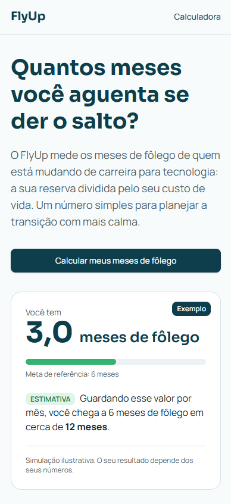 | 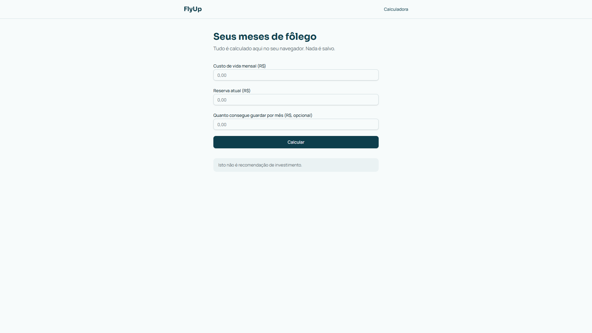 |

| Resultado e botão de ajuda | Estimativa até 6 meses de fôlego |
|---|---|
| 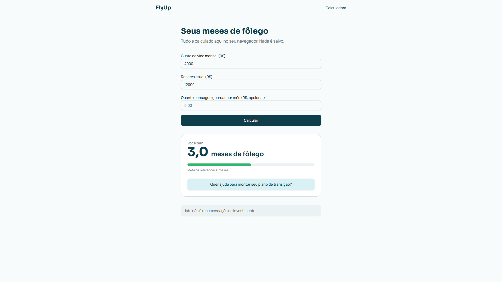 | 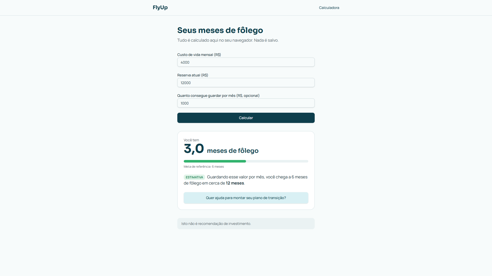 |

| Sem consentimento, o envio fica travado | Com consentimento, o envio libera |
|---|---|
| 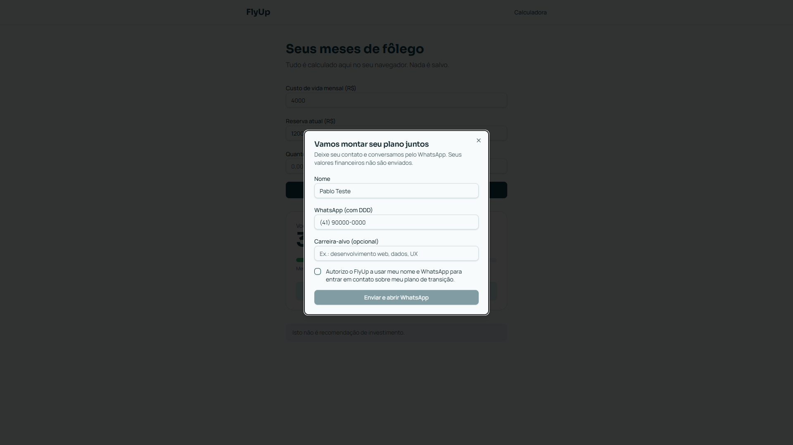 | 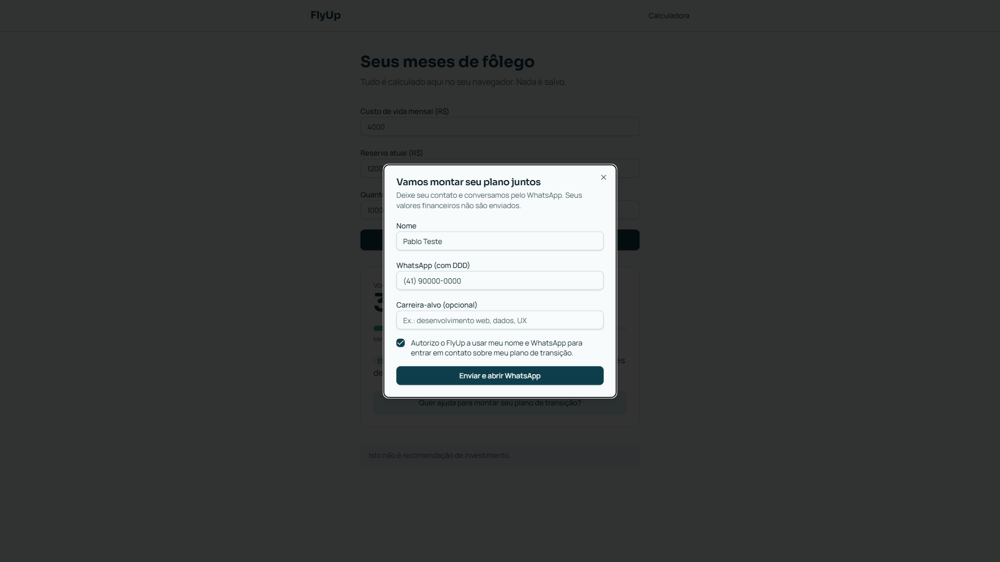 |

| Conversa aberta no WhatsApp (print inteiro, sem montagem) | Login do painel |
|---|---|
| 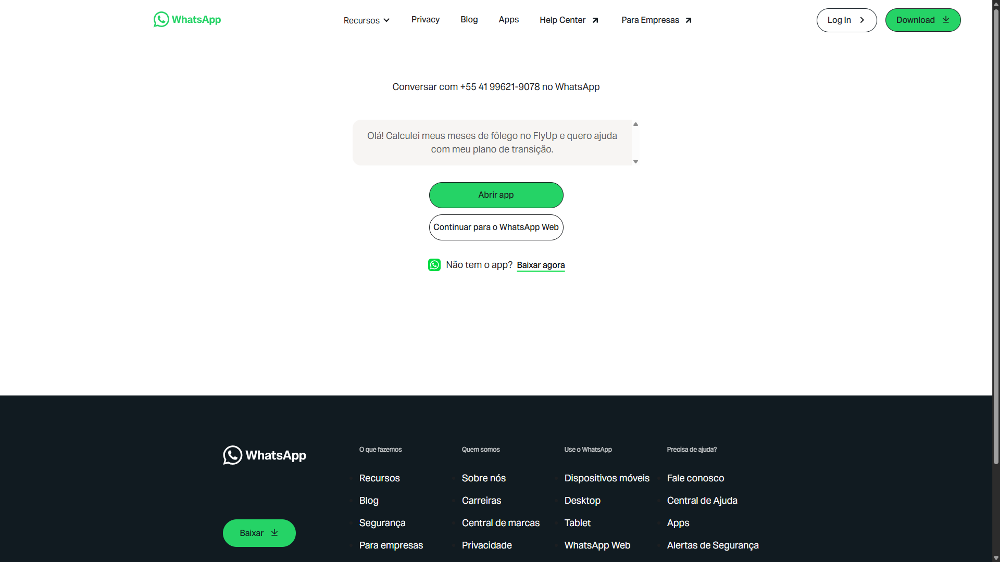 | 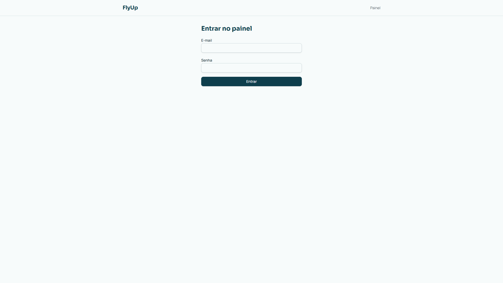 |

| Painel: mudança de status | Painel: status salvo |
|---|---|
| 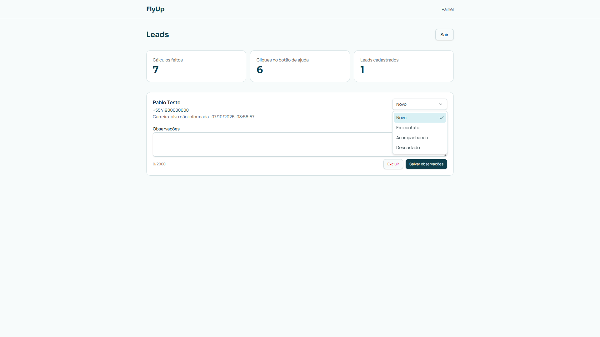 | 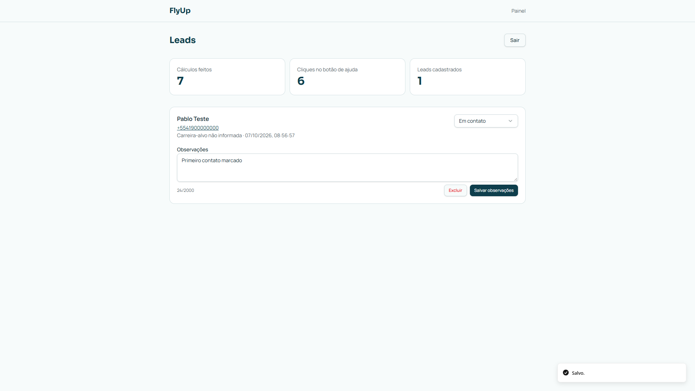 |

## O que ficou manual de propósito

- **Acompanhamento:** feito por mim, no WhatsApp Business do FlyUp (segunda a sexta, das 19h às 22h). É o serviço que a tese quer validar; automatizar antes disso seria construir no escuro.
- **Pagamento:** não existe na validação. Se houver cobrança, começa por link enviado à mão.
- **Plano de transição:** montado na conversa, não pelo app.
- **Fora do MVP:** chat com IA, integração bancária (Open Finance), e-mails e imagens geradas.
- **A conta não fica a cargo do modelo.** No capítulo 1, o protótipo gerado por IA somou um freela parcelado inteiro e mostrou +1,4 mês de fôlego quando o certo era +0,2. Aqui o cálculo é uma divisão determinística no navegador, sem IA no caminho do número.

## Dados e privacidade (LGPD)

| O quê | Como o FlyUp trata | Lei 13.709/2018 |
|---|---|---|
| Valores financeiros | Ficam só no estado da página, no navegador; nunca vão ao servidor | art. 6º, III (necessidade) |
| Dados do lead | Nome, WhatsApp, carreira-alvo (opcional), data e consentimento; nada além | art. 6º, III |
| Consentimento | Caixa obrigatória, com finalidade específica (contato sobre o plano de transição); sem ela, o botão fica desativado | art. 7º, I; art. 8º, caput e § 4º |
| Revogação e exclusão | Pedido pelo WhatsApp (processo manual); exclusão do lead no painel, só por administrador | art. 8º, § 5º; art. 18, VI e IX |
| Métricas | Só tipo de evento e data/hora; nenhum dado pessoal | art. 6º, III |

Texto oficial da lei: [Planalto](https://www.planalto.gov.br/ccivil_03/_ato2015-2018/2018/lei/l13709.htm). Artigos conferidos no texto oficial em 11/10/2026.

## Segurança

- **Row Level Security** nas três tabelas:

| Tabela | Público | Administrador |
|---|---|---|
| `leads` | só inserir | ler, alterar e excluir |
| `eventos` | só inserir | ler |
| `user_roles` | — | papéis atribuídos só por SQL |

- O papel de administrador é checado pela função `has_role()` (security definer, com `search_path` fixo).
- `/admin`: login por e-mail e senha, cadastro público desativado, acesso anônimo desligado e `noindex`. A fronteira real é o RLS, não a tela.
- O lead entra por função de servidor, com validação (Zod) e um campo anti-spam invisível (honeypot).
- **Chaves:** o `.env` versionado tem só a URL do projeto e a chave **publicável**, feita para o navegador. A [documentação do Supabase](https://supabase.com/docs/guides/api/api-keys) a classifica como segura para expor, inclusive em código-fonte, porque ela só alcança o que o RLS permite. A chave secreta (service role) é lida do ambiente, no servidor, e não aparece em nenhum commit.
- **Dependências:** `js-yaml` atualizado para 4.3.2, fechando GHSA-5p4m-2wfm-xmqj e GHSA-2883-xcg3-v3hh (negação de serviço; sem exposição em runtime, já que o app não lê YAML do usuário).
- **Integração com o GitHub** restrita a repositórios selecionados. O padrão oferecido era "All repositories".
- **Revisões:** deep scan do Lovable sem achados (04/10/2026); auditoria da URL publicada, com 9 arquivos JS sem chave secreta, JWT ou service role (05/10/2026, antes do card de exemplo); varredura do histórico do repositório até 06/10/2026, com 27 commits sem token, chave privada ou dado pessoal. As duas auditorias externas foram feitas por mim, com apoio do Claude.

## Como foi construído

1. **Validação com IA como co-founder** (Copilot): TAM/SAM/SOM, Business Model Canvas e hipóteses. Revisei com fonte oficial (IBGE) e mudei dois pontos: recomendação só de orçamento, nunca de investimento; e privacidade desde o desenho, com o cálculo no navegador.
2. **Mega prompt em Markdown** (abaixo) colado no Lovable em modo **Plan**. O Lovable fez 4 perguntas; revisei o plano e acrescentei 4 ajustes antes de aprovar:
   - validação de entrada (custo maior que zero, reserva não negativa) e nenhum evento `calculo_feito` para entrada inválida;
   - WhatsApp normalizado (sem máscara, com 55 na frente);
   - exclusão de lead só por administrador;
   - observações limitadas a 2.000 caracteres.
3. **Build e testes como cliente** (tabela de homologação abaixo). O administrador foi criado sem gastar crédito: usuário no painel do Lovable Cloud e papel atribuído por SQL.
4. **Uma mensagem de correção** antes de publicar: número comercial dedicado (não uso meu número pessoal) e atualização do `js-yaml`.
5. **Publicação** e auditoria da URL pública.
6. **Card de exemplo na landing**, com escopo travado na mensagem ao Lovable: mesmo componente e mesma função de cálculo da calculadora, selo "Exemplo", sem clique e sem evento de métrica.
7. **Código no GitHub** pelo sync do Lovable, com varredura do histórico antes de abrir o repositório.

<details>
<summary>Mega prompt usado no modo Plan do Lovable</summary>

```markdown
# FlyUp: MVP de validação

## Objetivo
Criar o MVP do FlyUp, um app para quem está em transição de carreira para tecnologia. A tese a testar: pessoas em transição querem medir quanto tempo aguentam financeiramente se derem o salto ("meses de fôlego") e aceitam acompanhamento para montar esse plano.
Todo o texto da interface em português do Brasil. Use o back-end do Lovable Cloud. Não gere imagens.

## Páginas

### 1. Landing page (/)
- Título: "Quantos meses você aguenta se der o salto?"
- Subtítulo explicando que o FlyUp mede os meses de fôlego de quem está mudando de carreira: a reserva dividida pelo custo de vida.
- Seção "Como funciona" em 3 passos: informe seu custo de vida, informe sua reserva, veja seus meses de fôlego.
- Seção "Seus números ficam com você": o cálculo acontece no seu navegador e nenhum valor financeiro é salvo.
- Botão principal levando à calculadora.

### 2. Calculadora (/calculadora)
- Campos: custo de vida mensal (R$), reserva atual (R$) e, opcional, quanto consegue guardar por mês (R$).
- Resultado: meses de fôlego = reserva ÷ custo de vida, com uma casa decimal.
- Se houver valor mensal guardado: estimar em quantos meses a pessoa chega a 6 meses de fôlego, sempre com o rótulo "estimativa".
- O cálculo é feito só no navegador. Os valores financeiros NUNCA são enviados ao servidor nem salvos.
- Aviso fixo: "Isto não é recomendação de investimento."
- Após o resultado: botão "Quer ajuda para montar seu plano de transição?", que abre o formulário de contato.

### 3. Formulário de contato
- Campos: nome, WhatsApp e carreira-alvo (opcional).
- Caixa de consentimento obrigatória: "Autorizo o FlyUp a usar meu nome e WhatsApp para entrar em contato sobre meu plano de transição." Sem ela marcada, não envia.
- Salva somente nome, WhatsApp, carreira-alvo, data e o consentimento. Nenhum valor financeiro.
- Campo invisível anti-spam (honeypot): se vier preenchido, descartar.
- Após salvar, abrir o WhatsApp pelo link oficial https://wa.me/NUMERO?text=MENSAGEM, com a mensagem "Olá! Calculei meus meses de fôlego no FlyUp e quero ajuda com meu plano de transição." Deixe o número como uma constante de configuração fácil de trocar.

### 4. Painel de administração (/admin)
- Acesso apenas com login (e-mail e senha) e somente para usuários com papel de administrador. Sem cadastro público.
- Lista de leads: nome, WhatsApp, carreira-alvo, data e status (novo, em contato, acompanhando, descartado).
- Permitir mudar o status e anotar observações por lead.
- Contadores simples para validação: total de cálculos feitos, cliques no botão de ajuda e leads cadastrados.

## Métricas sem dados pessoais
Registrar apenas o tipo do evento e a data/hora: "calculo_feito", "clique_ajuda", "lead_enviado". Nenhum valor financeiro e nenhum dado pessoal nesses eventos.

## Segurança (obrigatório)
- Row Level Security em todas as tabelas.
- Leads: o público pode apenas inserir; somente administradores podem ler e alterar.
- Eventos: o público pode apenas inserir; somente administradores podem ler.
- Nenhuma chave, token ou senha no código.

## Visual
Mobile-first, limpo e confiável. Fundo claro, azul-petróleo (#0F3D4C) como cor principal e verde (#2BB673) para destaques de progresso. Tom acolhedor e direto, sem julgamento sobre dinheiro.

## Fora do escopo
Pagamento, chat com IA, integração bancária (Open Finance), envio de e-mails e geração de imagens.
```

</details>

## Homologação

| # | Caso | Entrada | Esperado | Resultado |
|---|---|---|---|---|
| 1 | Cálculo | custo 3.200, reserva 9.600, guarda 800/mês | 3,0 meses; 12 meses até 6 meses de fôlego | OK (04/10 e 05/10) |
| 2 | Card de exemplo = demo | custo 4.000, reserva 12.000, guarda 1.000/mês | 3,0 meses; 12 meses, barra na mesma posição | OK (06/10) |
| 3 | Entrada inválida | custo 0 | erro na tela e nenhum evento registrado | OK (04/10) |
| 4 | Consentimento | enviar sem marcar a caixa | botão desativado | OK (prints 06 e 07) |
| 5 | WhatsApp | enviar lead com consentimento | conversa com o número comercial e a mensagem pronta | OK no site publicado (05/10, print 08) |
| 6 | Normalização | WhatsApp com máscara | painel mostra +55 e só dígitos | OK (04/10) |
| 7 | Painel | mudar status, anotar, excluir | status salvo; até 2.000 caracteres; exclusão pede confirmação | OK (04/10, prints 10 e 11) |
| 8 | Acesso ao painel | abrir `/admin` sem login | pede login; sem cadastro público | OK (print 09) |
| 9 | Exposição pública | bundle JS da URL publicada | nenhuma chave secreta | OK (05/10) |
| 10 | Regressão do card | resultado real, modal e consentimento | tudo intacto no desktop e no celular | OK (06/10) |

## Limitações conhecidas

- **Sem limite de taxa** no envio de leads: o honeypot barra robôs simples, não abuso dirigido.
- **Meta fixa de 6 meses** na estimativa: simplificação; a meta certa varia com o perfil de cada pessoa.
- **O contador "Leads cadastrados"** mostra os leads atuais e cai quando um lead é excluído. A métrica de validação é o evento `lead_enviado`.
- **O app não registra visitas:** o funil próprio começa no `calculo_feito`, então a taxa de uso sobre visitantes não é medida.
- **Sem eliminação automática** de dados (art. 16 da LGPD): hoje a exclusão é manual, pelo painel.
- **Mercado:** TAM, SAM e SOM são hipóteses, não medições.
- **Ainda sem tráfego real:** os números dos prints são de teste.
- Na prévia do editor do Lovable, o link do WhatsApp é bloqueado pelo quadro da página; no site publicado, funciona.
- No celular, "3,0 meses de fôlego" quebra a linha (cosmético).
- A varredura de segredos foi feita por padrões de texto, sem ferramenta dedicada; o RLS foi conferido nas migrations do repositório, não no banco ao vivo.

## Lições aprendidas

- **Conta é código, não modelo.** O erro de +1,4 mês do capítulo 1 virou regra: número que decide algo sai de função determinística.
- **Plano antes do Build.** Revisar o plano do Lovable e acrescentar 4 ajustes custou menos que corrigir depois.
- **Escopo travado na mensagem.** Pedir o card de exemplo com limites explícitos (mesma função, sem evento, sem dependência) evitou regressão.
- **Conferir antes de publicar.** Lei citada só depois de ler o texto oficial; chave e dado pessoal procurados no bundle e no histórico antes de abrir o repositório.

## Arquitetura em uma linha

Navegador (cálculo no estado da página) → função de servidor com Zod e honeypot (só para o lead) → Postgres do Lovable Cloud com RLS → painel `/admin` autenticado, que lê os leads via `has_role()`.

## Próximas evoluções (ideias, não compromissos)

- Seletor de perfil para a meta de fôlego.
- Prazo de retenção com eliminação automática.
- Alerta de novo lead por e-mail.
- Converter lead em cliente no painel.
- Lembrete mensal "recalcule seu fôlego" pelo WhatsApp, quando houver leads.

## Stack

- TanStack Start (React), TypeScript, Tailwind CSS, Zod
- Lovable Cloud (Postgres com RLS e autenticação, base Supabase)
- Publicado em lovable.app; construído com Lovable (Plan e Build) a partir de mega prompt em Markdown

## Autor

Pablo Rosa Gomes — [github.com/Pablit0rg](https://github.com/Pablit0rg)
